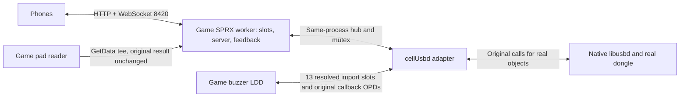

> Workspace update, 2026-10-30: the app sources are in `plugin/autoload/`,
> with the new menu, local SELF builder/installer and in-place ISO patcher.
> See the workspace `REPORT.md` and `ps3/README.md` for the current behavior,
> build command, byte-equality checks, publication boundary and console steps.
> New screens, builder/install integration and PS3 ISO patching are NOT console
> tested. S4E7/S4L3 console verification is pending. The older notes below
> describe the retained phone/game plugin and its previous evidence.

# PS3 virtual Buzz: game-process adapter

Updated 2026-10-26: the game-process SPRX is now cross-compiled and linked with the installed read-only PS3DK v0.26.0. Outputs are `build/ps3buzz.sprx`, `build/ps3buzz.fake.sprx`, `build/ps3buzz.prx` and config. Native PRX/relocation/sample checks and PC tests pass. **No PS3 load or console behavior has been tested in this run.** No console connection, screen/input automation, emulator launch, toolchain installation or game-file modification occurred. See [README.md](plugin/README.md) for the concrete first-console-test procedure and [TOOLCHAIN.md](plugin/TOOLCHAIN.md) for exact build commands.

The final choice is **one SPRX injected into the game process**, hooking its resolved `cellUsbd` import slots, with pads/phone server in that same process. The former VSH + LV2 syscall-hook plan is superseded. `plugin/kernel` and `plugin/vsh` remain regression/reference code; their inert native entry/bridge must not be installed. There is no chosen kernel payload or new syscall/mailbox transport to implement.

## Evidence first

[GAME_ANALYSIS.md](plugin/GAME_ANALYSIS.md) records the ELF hash, thirteen FNIDs, every import slot, LDD registration/probe identities, callbacks, wired startup, report handling, light setup, two-dongle limit and exact pad-mode patch candidates. It distinguishes static evidence from measured behavior. [game_audit.json](research/game_audit.json) is reproducible derived metadata; `python research/verify_game.py` verifies it against the user's read-only ELF.

The controller-mode strings are scripting **assignment policies**, registered under `INPUT_MAPPING_ALGORITHM`, and read by the Lua binding `ClearAndRestartMappingDevices`. A built-in pad path exists. It is **not a verified turnkey pad-only solution**: FIXEDPADS has a legacy fourth-channel defect, buzzer-presence checking is separate, and no USRDIR scripts were supplied. Smallest startup selector: decrypted ELF offset **0x9292f, 05 -> 01**; later script calls can override it. A persistent one-instruction selector override is VA **0x9f904**, `7cbc2b78 -> 3b800001`; correcting the fourth channel additionally needs VA **0x9f043, 04 -> 03**. None was applied. Future no-permanent-change testing must use process memory, expected bytes and proper PPU code-cache maintenance. Offsets do not apply to encrypted EBOOT.BIN or other builds.

Public evidence inspected in this session:

| Source | Relevant evidence |
|---|---|
| [RPCS3 Buzz.cpp, 39fe6c2](https://github.com/RPCS3/rpcs3/blob/39fe6c2599f3f03b68940df1cad22305e78106b9/rpcs3/Emu/Io/Buzz.cpp) | `expected_count = 5`; VID/PID 054c:0002, descriptors, button expressions, light bytes, 100us/6000us simulation delays. |
| [RPCS3 cellUsbd.cpp](https://github.com/RPCS3/rpcs3/blob/39fe6c2599f3f03b68940df1cad22305e78106b9/rpcs3/Emu/Cell/Modules/cellUsbd.cpp) | Public export names; much of this HLE implementation is stubbed. |
| [PSL1GHT usb.h](https://github.com/ps3dev/PSL1GHT/blob/f649a08fd536a9e27c08c7db2d93a2d7ee4c3bbe/ppu/include/usb/usb.h) | Public LDD and transfer callback signatures, descriptor/request layouts. |
| [Cobra PS3MAPI core](https://github.com/xXEvilnatXx/Cobra-PS3/blob/608ac4aa052e69ad50e84d9509b8010257b7f331/8.5/4.92/CEX/SRC/stage2/ps3mapi_core.c) | `prx_load_module(process, 0, 0, path)` followed by starting the custom module in that process. |
| [HEN PS3MAPI core](https://github.com/PS3Xploit/PS3HEN/blob/6c529455261db97a0f9028fe96db522a97fd5ccc/payload/ps3mapi_core.c) | Same process-module loading capability, including `prx_start_module_with_thread`. |
| [webMAN PS3MAPI](https://github.com/aldostools/webMAN-MOD/blob/45025987231248e4939a9f00ef851aa4aa0a5345/include/ps3mapi/ps3mapi.h) | `PS3MAPI_OPCODE_LOAD_PROC_MODULE` is 0x0044; process-targeted loading differs from VSH boot-plugin loading. |
| [RPCS3 cellPad.cpp](https://github.com/RPCS3/rpcs3/blob/39fe6c2599f3f03b68940df1cad22305e78106b9/rpcs3/Emu/Cell/Modules/cellPad.cpp) | Public GetData/change-notification behavior; pad input must preserve unchanged state. |
| [Physical descriptor reference](https://gist.github.com/AJFaraday/d9cb53f2583d6f5c2eaf) and saved Linux sources | HID descriptor reconstruction and LED-output comparison from Phase 1; not a capture of this user's dongle. |

Source snapshots and original license notices are retained under `research/`. This session fetched source text only. The presence of a feature in current public source does not prove the user's installed payload version exposes it identically.

## USB contract established by the game

The game registers four extra LDDs: 054c:1000-1040; 054c:0001-0041; **054c:0002-0042**; 046d:c220. Probe then accepts only Sony PIDs 1000,1020,1040,0001,0021,0041,0002,0022,0042 and Logitech c220. These are two different filters. RPCS3's broad passthrough whitelist is not the game's exact predicate.

The selected virtual identity remains **wired 054c:0002**, with two devices maximum. Descriptor fields in `core/usb_model.c` mirror RPCS3: one HID interface, EP81 interrupt-IN, max packet 8, interval 10; no OUT endpoint. The game derives its receive allocation from the endpoint and caps it at 16. It uses five input bytes, with four five-bit handset groups in bytes 2-4. Per group, bits 0-4 are red/yellow/green/orange/blue. Idle is `7f 7f 00 00 f0` in RPCS3; all buttons is `7f 7f ff ff ff`. Native idle axes/vendor bits were not captured here.

The reconstructed wired startup is: Init -> four registrations -> probe/static device descriptor -> location -> static config/interface/endpoint/device descriptors -> EP0/IN pipes -> private data -> GET_DESCRIPTOR(product string, English 0409, capacity 128) -> SET_CONFIGURATION -> **SET_INTERFACE(0,0)** -> all lights off + IN transfer -> asynchronous callback -> rearm IN. The missing SET_INTERFACE request is now implemented in `core/usb_model.c`; no mismatch was found in `buzz.c`'s encoder, so its bit layout remains unchanged.

Light setup is now established from this game: `type=21, request=09, value=0200, index=interface, length=7`; payload `[00,L1,L2,L3,L4,00,00]`. With the virtual interface zero, the USB wire setup is `21 09 00 02 00 00 07 00`. A device advertising OUT may take a different branch; our wired profile uses EP0 control output.

The game immediately rearms IN, even after an error. A five-report ring drops excess reports and its update path consumes the latest button word. There is no measured native interval from this executable. The profile's 10ms endpoint interval and model's **6ms IN / 100us control** deadlines come from RPCS3/reference descriptors; RPCS3 itself marks the 6ms value as needing measurement. The source candidate's 1ms pump is subject to scheduler jitter.

The 78-byte HID report descriptor is still reconstructed from the saved decoded physical reference, not a captured binary. Device revision, string index and HID country differ among RPCS3 and that reference. This game's wired attachment scans cached descriptors and does not request/parse the HID report descriptor, reducing the practical startup dependency on that reconstruction. Other titles may differ.

## Architecture decision

| Layer | Decision and evidence |
|---|---|
| Built-in pad assignment | Useful small diagnostic experiment, insufficient for the full phones/mixed-eight-player goal. Legacy channel 4 and separate presence policy prevent claiming a complete quick win. |
| LV2 sys_usbd adapter | Superseded. It requires firmware-sensitive hooks, native handle allocation and event/wait integration. The game executable does not resolve those kernel details. |
| **Game-process import slots** | **Chosen.** Exactly thirteen public USB imports cover this title's driver. Existing import trampolines load compact OPDs through writable slots. A SPRX can preserve original OPDs and route virtual objects locally. Cobra and HEN both have process-module loaders. No dev_flash or game-file write is required. |
| Global libusbd export patching | Unnecessary. Patch this game's resolved imports, not every process/module's exports. Unknown titles need separate import discovery/profile validation. |

All hub mutation is serialized. Input captures use a **fourteenth import hook**, `sys_io` / cellPadGetData FNID **8b72cda1**. It calls the original API and tees successful changed data, rather than polling GetData independently in the same process and consuming a notification before the game sees it. The worker reads connection status through GetInfo2, maps snapshots about every 8ms, serves the phone page and pumps virtual completions about every 1ms. It never initializes/ends the game's shared pad/network subsystems. Actual native GetInfo2 support, network readiness and interaction with the game's pad cache remain untested.

The USB adapter owns only its process-local synthetic IDs and completion records. **Public Transfer calls return submission status 0**, followed later by `(result,count,arg)` callbacks; they do not expose model transfer IDs to native libusbd. Setup/OUT buffers are copied at submission, IN storage is filled before completion, and a callback can resubmit without recursion or holding the adapter mutex. Close cancels queued requests; a callback already executing causes a busy result. Detach preserves private data while the game detach callback runs, then clears pipes/state/lights. Live force-unloading is unsupported.

Late injection is explicitly implemented for this build: after the manager's ready byte at 0x78ab14 is 1, adopt the static wired buzzer2 LDD callback record at 0x760174 without repeating native registration. Probe/attach are deferred, so a supplied real dongle can occupy its native slot first. If the game's two-device limit is already full, the virtual probe is rejected. General late discovery, other title versions and reattachment after a real-device hotplug need further work; this is a BCES00347 profile, not universal support.

`game/import_hook.c` parses validated import-table bounds by NID, builds a complete plan before writes, compares original pointers, rolls back failed installs and restores only owned slots. `game/native.c` adds the actual wrappers, build fingerprint, late adoption, worker and server/pad integration. It passes both PC syntax checking and the native PPU build. The SDK PRX validator, independent relocation audit and offline signed-container decryption pass; console loader/OPD/runtime behavior remains unverified.

Virtual IDs are not LV2 IDs. Before exposing a device, the current candidate requires native GetDeviceLocation to return DEVICE_NOT_FOUND for its reserved ID. A different native error fails closed and is a console-test blocker, not permission to guess an ID. Known real reserved-range pipes are tracked; a later collision with a live virtual pipe fails the new allocation rather than routing it to the wrong device. Namespace/error behavior and native real-dongle coexistence are unverified.

## Mapping, phones and feedback

| Buzz | Default pad | Extra player with players_per_pad=2 |
|---|---|---|
| Red | R1 or R2 | L1 or L2 |
| Blue | Triangle | D-pad Up |
| Orange | Square | D-pad Left |
| Green | Circle | D-pad Right |
| Yellow | Cross | D-pad Down |

`plugin/ps3buzz.cfg` is loaded once from `/dev_hdd0/plugins/ps3buzz/ps3buzz.cfg`; the shipped first-test file explicitly enables USB, while compiled defaults remain disabled. Missing/invalid config refuses native startup. Fixed `pad.N.right`/`pad.N.left` targets and `off` are supported in addition to automatic free-slot assignment. Two dongles provide eight virtual handset slots; `dongles=1` provides four, useful with one real dongle. Seven normal pad ports are the maximum represented by the public pad API, and the game may initialize fewer. A phone or split pad supplies player eight. Historical connection timestamps are unavailable: first discovery uses port order; later devices take free slots. Existing owners are not moved/stolen. Split-pad halves claim separate slots; a physical handset is not mirrored into that pool. Real+virtual enumeration order is not promised.

Mapping uses `map.right.red=r1|r2` and equivalent named keys. The ambiguous name `x` is rejected; `cross` is yellow. Phone and pad claims share the same pool. Source reference `ref-buzz-web-controller` stays read only; copied assets retain Remus Turcu's MIT notice and original hashes. The missing external buzz-pad-bridge PLAN.md was not supplied, so the split mapping is this project's documented choice.

The original fixed HTTP routes and flat JSON protocol remain: `join` with slot 1-8 (or 0 for free), `down`/`up` with a color; replies `joined`, `join_rejected`, `status`; extension `lights`. Closing/error releases ownership and buttons. The page releases held buttons on blur/visibility loss. Default stale timeout is 45 seconds, with ping/pong checks. A dead Wi-Fi link can therefore remain pressed until timeout. The old kernel mailbox watchdog is **not** part of the new architecture; a stalled game worker can stop USB completions until the game exits.

The bounded nonblocking server has 16 peers, a 4095-byte request cap, 16KiB output per connection and 512-byte frame payload cap. It serves assets and read-only `/health.json`, with no file browser/admin API. It accepts masked short ASCII JSON, split/coalesced TCP input, ping/pong and close. Continuation frames, fragmented application messages, binary application data and non-ASCII text are rejected. This is the intended restricted browser subset, not a general RFC6455 implementation. Same-origin checking is not authentication; it is a LAN service without TLS. PC tests bind only 127.0.0.1.

Lights update the hub directly and are sent to phones. Rising pad light produces an 80ms large-motor cue at 48/255. Split-player lights combine on one physical pad; they cannot be indicated independently by one motor. The game can also set rumble; native interaction and latency are untested. DS3 LEDs are not repurposed.

## Toolchain, validation and remaining limits

The selected layer needs a **PPU user-space game SPRX SDK only**. It needs neither a VSH SPRX nor a new kernel plugin, kernel compiler, firmware offsets or custom syscall. [TOOLCHAIN.md](plugin/TOOLCHAIN.md) records the installed PS3DK Windows build, process-runtime fixes, output validation and exact commands.

Run `python plugin/tests/run_all.py` and `python research/verify_game.py`. [TEST_RESULTS.md](plugin/TEST_RESULTS.md) captures commands/compiler/results: exhaustive 2^20 report agreement, existing core/transport/parser tests, reconstructed two-dongle game sequence, all forty bits, real API forwarding, callback rearm, cancellation, late adoption, namespace conflicts, import rollback, sanitizers and native-source syntax checking. The fixture is independently written C, not the game's executable or an emulator.

Remaining native questions are precise: resolved OPD layout and writable import slots; resident module packaging; safe mapped-address reads; actual invalid-ID error and handle namespaces; libusbd callback threading; game mutex interactions; pad notification/cache behavior; game network initialization; completion timing; real hotplug; force-unload hazards; other title profiles; full gameplay and TRC gates. Static evidence and Windows tests do not settle these. A game-process crash can lose unsaved progress or hang the console; this design avoids the broader persistent kernel-hook exposure but cannot promise harmless execution.

[README.md](plugin/README.md) contains the exact webMAN 1.47.48a first test and game-exit undo instructions. [REVIEW.md](plugin/REVIEW.md) is Claude's current handoff. No console installation was performed.

## LV2 comparison reference, no longer the injection target

**Correction to Phase 1:** RPCS3's sys_usbd_open_pipe has **seven native arguments**. Its eighth C++ parameter is `ppu_thread&`, an emulator context. The previous report miscounted it; the claimed 7-vs-8 discrepancy was not real. This does not independently establish Sony's implementation.

The saved [RPCS3 sys_usbd.h](https://github.com/RPCS3/rpcs3/blob/39fe6c2599f3f03b68940df1cad22305e78106b9/rpcs3/Emu/Cell/lv2/sys_usbd.h) and [syscall bindings](https://github.com/RPCS3/rpcs3/blob/39fe6c2599f3f03b68940df1cad22305e78106b9/rpcs3/Emu/Cell/lv2/lv2.cpp) give the table below; P1 denotes the historical PSDevWiki comparison. `H`, `D`, `P`, `T` are u32 context, device, pipe, transfer handles; `ptr` is a userspace address requiring validated copy. `ppu_thread&` is emulator context and is **not** a syscall argument. Public API callback pointers are managed by libusbd, not passed as callbacks to 543. Numeric result/count and request structure u16 members use the PPU ABI's big endian; actual USB descriptor bytes remain little endian.

| Dec (hex) | sys_usbd suffix | Arguments established in RPCS3 / remaining uncertainty |
|---|---|---|
| 530 (212) | initialize | ptr(u32 out H) |
| 531 (213) | finalize | H |
| 532 (214) | get_device_list | H, ptr(4-byte entries), u32 max_devices; returns number copied |
| 533 (215) | get_descriptor_size | H, D; returns size |
| 534 (216) | get_descriptor | H, D, ptr(out bytes), u32 size |
| 535 (217) | register_ldd | H, ptr(product/name string), u16 string_length |
| 536 (218) | unregister_ldd | H, ptr(name), u16 length |
| 537 (219) | open_pipe | H, D, u32 unknown1, u64 unknown2, u64 unknown3, u32 endpoint, u64 attributes; **7 native arguments; ppu_thread is emulator-only** |
| 538 (21A) | open_default_pipe | H, D |
| 539 (21B) | close_pipe | H, P |
| 540 (21C) | receive_event | H, ptr(u64 arg1), ptr(u64 arg2), ptr(u64 arg3); blocking |
| 541 (21D) | detect_event | RPCS3/P1 expose no args; stub |
| 542 (21E) | attach | H, u32 unknown1, u32 unknown2, D; stub |
| 543 (21F) | transfer_data | H, P, ptr(buffer), u32 length, ptr(8-byte setup or null), u32 type; returns T |
| 544 (220) | isochronous_transfer_data | H, P, ptr(iso request) |
| 545 (221) | get_transfer_status | H, T, u32 unknown1, ptr(u32 result), ptr(u32 count) |
| 546 (222) | get_isochronous_transfer_status | H, T, u32 unknown1, ptr(iso request), ptr(u32 result) |
| 547 (223) | get_device_location | H, D, ptr(7 location bytes) |
| 548 (224) | send_event | RPCS3 no-arg stub; P1 says **2 unknown arguments** |
| 549 (225) | event_port_send | H, u64 arg1, u64 arg2, u64 arg3; RPCS3 injects these into its internal queue |
| 550 (226) | allocate_memory | RPCS3 no-arg stub; P1 says **3 unknown arguments** |
| 551 (227) | free_memory | RPCS3 no-arg stub; P1 says **2 unknown arguments** |
| 552 (228) | unknown / enable_wake_on? | unbound in RPCS3; P1 says 1 argument |
| 553–555 (229–22B) | unknown | unbound; P1 says void |
| 556 (22C) | get_device_speed | RPCS3 no-arg stub; P1 says 3 args, last ptr(u8 output); first two not established |
| 557 (22D) | unknown | unbound; P1 says 5 arguments |
| 558 (22E) | unregister_extra_ldd | H, ptr(name), u16 length |
| 559 (22F) | register_extra_ldd | H, ptr(name), u16 length, u16 VID, u16 minimum PID, u16 maximum PID |

Do not treat the old PSL1GHT `sys/usbd.h` wrappers as authoritative: the saved source uses undefined `unk1` in two wrappers. RPCS3's iso request contains a 32-bit buffer pointer, start_frame, num_packets and eight u16 packet entries. Buzz's endpoint is interrupt, so ISO transfers on real pipes should pass through unchanged.

Event triples in the saved RPCS3 implementation: attach `(1,D,0)`, detach `(2,D,0)`, completion `(3,T,0)`, termination type 4. On completion, 545 writes controller result zero for success and actual count five for input. RPCS3 enforces T < 0x44. Its initialize comment notes native LV2 can have multiple contexts even though its emulator only supports one. **Never copy its fixed context handle 0x115B or invent large transfer IDs for real libusbd.**

## Native build and late-presence follow-up

The input ELF hash and game audit were rerun. Profile generation verifies the full original ELF SHA-256, then emits CRC fingerprints of 33 immutable ranges and fourteen expected slots. Native startup checks those ranges, mapped OPDs/code and the exact slot addresses before any compare/replace. It refuses the user's separate four-word pad-route build; use the original game for USB testing. No pad-route patch is applied.

Native runtime avoids the executable CRT and local allocator: config/log use LV2 filesystem calls, formatting/HTTP/config parsing are bounded, and sockets use raw sys_net imports. The process module maps about 434 KiB plus its 64 KiB thread stack. A bounded 128 KiB HDD log records hooks, adoption, probe/attach, control/sampled IN events, pads and the game's own count/presence.

The adopted record is buzzer2 at 0x760174 (PID 0002?0042), replacing the older candidate's use of the overlapping buzzer1 range. Attach 0xbd300 increments manager +0xa8; update 0xbd638 writes manager +0x69/+0x8d when setup is ready. These are exactly the bytes read by 0x97748/0x97818 and 0xbc0a8. Late attachment therefore has a static path to the retail presence checks without bypass patches. Runtime log confirmation is required. No earliest-load restriction was established.

The user reports a working four-word pad route on two DualShocks with a real buzzer still required, and a freeze on match start. Those console observations are user-supplied context, not measurements from this run. The freeze was not investigated.
